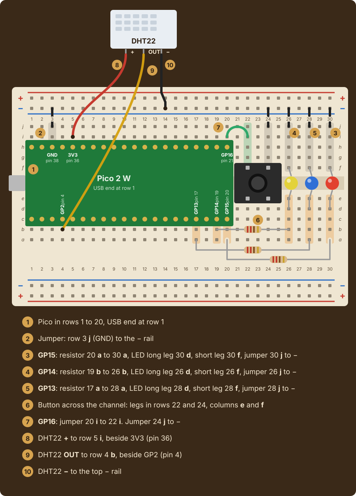
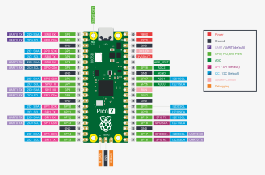
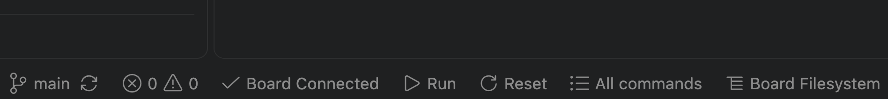

# Lab 8: Thermometer

|Item |       |
|:----|:------|
|Released |Friday, November 13, at the lab session |
|Due |Friday, November 20, 2:30pm |
|Progress |[](../../actions/workflows/main.yml) |

Your kit has two thermometers: the DHT22 sensor module, which measures the temperature and the
humidity of the air, and a temperature sensor built into the Pico's chip. In this lab your team
builds a thermometer that lights one of three LEDs for cold, warm or hot, flashes it when the air is
too dry or too humid, and keeps a log of what it measured. It also compares the two thermometers,
since the chip warms itself as it runs.

`Sensors` reads both sensors, `Comfort` decides whether a temperature and a humidity are
comfortable, a `Display` drives the three LEDs, and a `Log` keeps the readings and works out the
highest, lowest and average. The provided `main.py` brings them together. Each of you writes one
class in its own file, on your own branch, and merges it through a pull request that two teammates
approve.

## Contents

* [Course learning outcomes](#course-learning-outcomes)
* [Your team](#your-team)
* [The circuit](#the-circuit)
* [The classes](#the-classes)
  * [How the classes connect](#how-the-classes-connect)
  * [Sensors, in sensors.py](#sensors-in-sensorspy)
  * [Comfort, in comfort.py](#comfort-in-comfortpy)
  * [Display, in display.py](#display-in-displaypy)
  * [Log, in log.py](#log-in-logpy)
  * [The program, in main.py](#the-program-in-mainpy)
  * [Expected output](#expected-output)
* [Working as a team](#working-as-a-team)
* [Getting started](#getting-started)
  * [Testing on your Pico](#testing-on-your-pico)
* [Evaluation](#evaluation)
* [Code review](#code-review)
* [Submitting](#submitting)

## Course learning outcomes

This lab addresses the following course learning outcomes:

**CLO 1.** Apply Python programming fundamentals to execute and explain computer code that
implements interactive, novel solutions to a variety of computable problems.

**CLO 2.** Implement code consistent with industry-standard practices using professional-grade
integrated development environments (IDEs), command-line tools, and version control systems.

**CLO 5.** Design, describe, and implement original projects incorporating industry-standard
practices and Python language fundamentals.

Specifically, by the end of this lab you should be able to:

* write methods that answer a question about an object, and methods that call other methods of
  the same object with `self`
* explain how a class hides the details of its work behind its methods (abstraction), and why
  other code changes an object's data only through its methods (encapsulation)
* read an analog value on the Pico with `ADC`, and the temperature and humidity of the air with a
  DHT22
* work on a branch, open a pull request, review two teammates' pull requests, and merge your own

## Your team

Your team from Lab 7 shares this one repository. The work is divided into four files, and each
person takes one:

|File |What it holds |
|:----|:-------------|
|`src/sensors.py` |the `Sensors` class |
|`src/comfort.py` |the `Comfort` class |
|`src/display.py` |the `Display` class |
|`src/log.py` |the `Log` class |

`src/main.py` is provided, so nobody needs to change it.

Please agree on who takes which file before anyone writes code. A team of three has one extra
file, so please plan together how you will complete it, for example together during a lab, on its
own branch and with its own pull request.

## The circuit

Please keep your Lab 7 circuit: three LEDs on GP15, GP14 and GP13, and the push button on GP16.
The LED on GP15 shows hot, GP14 shows warm, and GP13 shows cold. Then connect the DHT22 module from
your kit with three jumper wires, each into the breadboard row of the Pico pin it names. Remember to
unplug the USB cable before you touch the wiring.

|DHT22 pin |Pico pin |
|:---------|:--------|
|`+` |3V3 (physical pin 36) |
|`OUT` |GP2 (physical pin 4) |
|`-` |GND (physical pin 38) |

The temperature sensor inside the chip needs no wiring.





## The classes

The Week 11 slides and
[Methods, Abstraction, Encapsulation](https://computationalexpression.com/slides/week-12-session-3/)
cover what this lab asks for.
The class names, method names and the attributes named below must match exactly, because the
automated checks use them, and because your teammates' code calls yours. You can choose the other
names yourself. The `TODO` comments in your file walk through each method, and you write a
docstring for your class and for each of its methods in your own words.

### How the classes connect

`main.py` makes one object of each class, then repeats these steps every two seconds, which is
how long the DHT22 needs between readings:

1. It asks `Sensors` to `read_air()`, then for `air_fahrenheit()` and the `humidity`. `main.py`
   does not need to know how the DHT22 works.
2. It asks `Comfort` for the `level` of the temperature: `"cold"`, `"warm"` or `"hot"`.
3. It tells the `Log` to `record` the temperature, the humidity and the level.
4. If `Comfort` says the `humidity_level` is `"comfortable"`, it tells the `Display` to `show` the
   level, which keeps one LED lit. If not, it tells the `Display` to `flash` it twice.

When the readings end, `main.py` turns the LEDs off and prints the log from the `Log`'s methods,
with how much warmer the chip is than the air from `Sensors`' `difference()`.

### Sensors, in sensors.py

`Sensors` holds the DHT22 that measures the air, and the sensor inside the Pico's chip.

The DHT22 is made with `dht.DHT22(Pin(2))`, from MicroPython's `dht` module. Its `measure()`
method takes a new reading, and then `temperature()` returns it in degrees Celsius and `humidity()`
returns the humidity in percent.

The chip's sensor is made with `ADC(4)`, and its `read_u16()` method returns a number from 0 to
65535. These formulas turn that number into degrees:

|Value |Formula |
|:-----|:-------|
|voltage |reading × 3.3 ÷ 65535 |
|Celsius |27 − (voltage − 0.706) ÷ 0.001721 |
|Fahrenheit |Celsius × 9 ÷ 5 + 32 |

|Method |What it does |
|:------|:------------|
|`__init__(self, air_pin)` |Stores `ADC(4)` and a DHT22 on `air_pin`, and `air_celsius`, `humidity` and `readings` as `0` |
|`read_air(self)` |Calls the DHT22's `measure()`, stores its `temperature()` in `air_celsius` and its `humidity()` in `humidity`, and adds 1 to `readings` |
|`air_fahrenheit(self)` |Returns `air_celsius` in degrees Fahrenheit |
|`chip_fahrenheit(self)` |Reads the chip's sensor and returns its temperature in degrees Fahrenheit, with the formulas above |
|`difference(self)` |Returns `self.chip_fahrenheit()` minus `self.air_fahrenheit()` |

### Comfort, in comfort.py

`Comfort` holds the dividing values that sort a temperature and a humidity into levels.

|Method |What it does |
|:------|:------------|
|`__init__(self, cold_below, hot_above, dry_below, humid_above)` |Stores the four values: two temperatures in degrees Fahrenheit and two humidities in percent |
|`level(self, fahrenheit)` |Returns `"cold"` below `cold_below`, `"hot"` above `hot_above`, and `"warm"` otherwise, including at the two dividing temperatures |
|`humidity_level(self, humidity)` |Returns `"dry"` below `dry_below`, `"humid"` above `humid_above`, and `"comfortable"` otherwise |
|`is_comfortable(self, fahrenheit, humidity)` |Returns `True` when the level is `"warm"` and the humidity level is `"comfortable"`, using the two methods above |
|`describe(self, fahrenheit, humidity)` |Returns a string with the temperature and the humidity, each rounded to one decimal place, and both levels, such as `72.5 F, warm, 44.0% humidity, comfortable`. `round(fahrenheit, 1)` does the rounding |

### Display, in display.py

A `Display` has one LED for each temperature level, with at most one of them on.

|Method |What it does |
|:------|:------------|
|`__init__(self, hot_pin, warm_pin, cold_pin)` |Stores a dictionary attribute `lights` with an output `Pin` for each of the keys `"hot"`, `"warm"` and `"cold"`, stores `showing` as `"off"`, and turns the LEDs off |
|`all_off(self)` |Turns each LED off with a loop over the dictionary, and sets `showing` to `"off"` |
|`show(self, level)` |Turns the three LEDs off with `self.all_off()`, then lights the LED for `level` and sets `showing` to `level` |
|`flash(self, level)` |Calls `self.show(level)`, then `sleep(0.5)`, then `self.all_off()` |
|`test_lights(self)` |Lights all three LEDs, calls `sleep(1)`, then turns them off |

### Log, in log.py

A `Log` keeps the temperatures and humidities measured in one place, and how many fell in each level.

|Method |What it does |
|:------|:------------|
|`__init__(self, place)` |Stores `place`, `temperatures` and `humidities` as empty lists, and `counts` as a dictionary with `0` for each of `"cold"`, `"warm"` and `"hot"` |
|`record(self, fahrenheit, humidity, level)` |Appends the temperature to `temperatures` and the humidity to `humidities`, and adds 1 to the count for the level |
|`highest(self)` |Returns the highest temperature, with a loop that starts from the first one in the list |
|`lowest(self)` |Returns the lowest temperature, the same way |
|`average_humidity(self)` |Returns the total of the humidities, added up in a loop, divided by how many there are |

`main.py` records a reading before it asks for any of these, so the lists are not empty when they
run.

### The program, in main.py

`main.py` is provided, and it is worth reading to see how your class is used. It asks where the
thermometer is and how many readings to take, makes the four objects, and tests the lights. Then
it takes a reading every two seconds until it has taken that many or the button is pressed, and
prints the thermometer log. The button is checked once after each reading, so please hold it down
until the next reading ends. `COLD_BELOW`, `HOT_ABOVE`, `DRY_BELOW` and `HUMID_ABOVE` near the top
set the levels. You are welcome to change them on your own computer to see each LED light in your
room.

### Expected output

Here is one run on the board with four readings, where breathing on the DHT22 warmed and dampened
the air around it during the last two:

```text
==================================================
THERMOMETER
==================================================
Where is the thermometer? Alden 101
How many readings should it take? 4
Press the button to stop early
Reading 1: 71.6 F, warm, 41.0% humidity, comfortable
Reading 2: 72.1 F, warm, 41.5% humidity, comfortable
Reading 3: 79.0 F, hot, 63.2% humidity, humid
Reading 4: 80.2 F, hot, 64.0% humidity, humid

==================================================
THERMOMETER LOG: Alden 101
==================================================
Readings: 4
Highest: 80.2
Lowest: 71.6
Average humidity: 52.4
Cold: 0
Warm: 2
Hot: 2
Chip warmer by: 7.8
Comfortable now: False
```

## Working as a team

You will follow the same steps as in Lab 7, so please see the Lab 7 README or
[Working as a Team on One Repository](https://computationalexpression.com/slides/week-11-session-3/)
for the commands and the VS Code buttons. In short:

1. **Update `main`**, then make a branch named for you.
2. **Write only your own file**, and commit and push it on your branch.
3. **Open a pull request.** This lab asks for **two approving reviews** on each pull request. In
   a team of three, each of you reviews both of the others. In a team of four, in alphabetical
   order by first name, each person reviews the next two people's pull requests, wrapping around
   from the last person to the first. In each review, please comment on at least one line before you
   choose **Approve**.
4. **Merge your pull request** with **Merge pull request**, not Squash and merge, once it has two
   approvals.
5. **Write your summary** in `docs/summary.md` on a new branch, after updating `main`. A summary
   pull request does not need a review. Once each teammate's answer is merged, please answer the
   last question together.

## Getting started

Open your file in `src` and work through its `TODO` markers. You can check your work as you go by
running this from the assignment's top-level folder, not from inside `src`:

```text
uv run gatorgrade --config gatorgrade.yml
```

Once all four classes are done, `uv run python src/main.py` runs the program on a laptop. A laptop
has no sensors or button, so its readings are not real, and it stops after the first reading
because it reads the button as held down. To see real temperatures, please run the program on the
Pico.

### Testing on your Pico

When all four files are merged, please pull `main` and run the thermometer on your own board. The
Run button sends only the file you have open, so the four class files need to be on the board
first. Open the folder of this lab in VS Code (File, Open Folder), then right-click each of
`src/sensors.py`, `src/comfort.py`, `src/display.py` and `src/log.py` in the Explorer, choose
MicroPico, then **Upload File to Board**. You will need to upload a file again each time it
changes. Then plug in the board, open `src/main.py`, and click **Run** in the bar along the bottom
of the window. You should see **Board Connected** beside it:



Breathing gently on the DHT22 raises its temperature and humidity within a few readings.

## Evaluation

This lab is worth **4.5 points**, the standard value for a lab in this course.

| Component | Points | What it measures |
|:----------|:-------|:-----------------|
| Programming | 3.0 | The 14 code checks below, which are the same for each teammate. Your score is the fraction passed, times 3.0 |
| Code quality and style | 1.0 | In the file you wrote: descriptive names (0.3), clear organization (0.3), useful comments (0.4) |
| Summary writing | 0.5 | Your answer in `docs/summary.md`, and the team's answer to the last question |
| **Total** | **4.5** | |

You can run the checks yourself, as many times as you like, before you submit:

```text
uv run gatorgrade --config gatorgrade.yml
```

Each check's description says what to look at when it fails. Under a failed check, gatorgrade
also prints a `uv run pytest ...` command, and when you run it, the last lines tell you what came
out and what was expected. Here are the fourteen code checks:

* `Sensors` makes both sensors, and `read_air()` measures the air and counts the reading
* `air_fahrenheit`, `chip_fahrenheit` and `difference` convert and compare the two temperatures
* `level` and `humidity_level` sort a temperature and a humidity into levels
* `is_comfortable` and `describe` answer from the two level methods
* `Display` keeps its Pins in a dictionary, starts dark, and `all_off` turns them off
* `show` lights one level's LED, `flash` lights it for half a second, and `test_lights` lights
  all three for one second
* `Log` starts empty, and `record` adds a reading and counts it
* `highest`, `lowest` and `average_humidity` work for any readings, including below zero
* the provided `main.py` runs with all four classes, flashes for uncomfortable humidity, and logs
  the readings correctly
* a press of the button stops the readings early
* at least four pull requests are merged with Merge pull request
* the files in `src` have commits from at least two teammates
* no `TODO` markers remain in `src`
* each file in `src` has a docstring for its class and each method, and at least two comments

Partial credit is proportional, so passing 10 of 14 checks earns `(10 ÷ 14) × 3.0 = 2.14` points.
The two remaining checks look at `docs/summary.md` and count toward Summary writing. The two
approving reviews on your pull request are part of the code review below.

> [!NOTE]
> Automated results are preliminary. Your instructor sets the final grade.

## Code review

Each teammate has their own code review with a Technical Leader or the instructor, about the
file they wrote and how it works with the others. **Code reviews are graded separately from the
4.5 points above**, under the Code Reviews category on the syllabus.

During the review, you will run the thermometer on your board for the reviewer and then answer
questions about your own code. The reviewer opens a **Code Review** issue on your team's repository
with your name on it. The questions differ from student to student, so please be ready to:

* **Methods and self**: explain how one of your methods uses another method or an attribute of
  the same object
* **Abstraction**: explain what your class lets other code do without knowing how it is done
* **Encapsulation**: explain which attributes your methods change, and why other code calls your
  methods instead of changing them directly
* **Pull requests and reviews**: show your pull request with its two approvals, and explain
  what you commented on in the two pull requests you reviewed

**Your review must be completed during the lab session on the day this lab is due.** If you
know in advance that you cannot attend that lab, make arrangements to complete your review
beforehand at office hours. If your team submitted this lab on time but you missed the code
review, you can make it up at office hours within one week of the due date:

* **Technical Leaders**, listed on the calendar at
  [cis.allegheny.edu/community/news](https://www.cis.allegheny.edu/community/news/)
* **Dr. Jumadinova**, [book a time](https://janyljumadinova.com/office-hours/). Drop-ins are welcome
  during posted hours, but students who booked are seen first

## Submitting

The `main` branch on GitHub at the deadline is what gets graded, so please merge your pull requests
before then. When you are done, open your repository on GitHub and confirm that each file and
`docs/summary.md` are on `main`.

If you need more time, you can apply a late token with [this form](https://forms.gle/3nGbpaNrG96DpLLdA).
One token covers both parts of a lab, the submission and the code review, but it covers only the
student who applies it and not the team.
